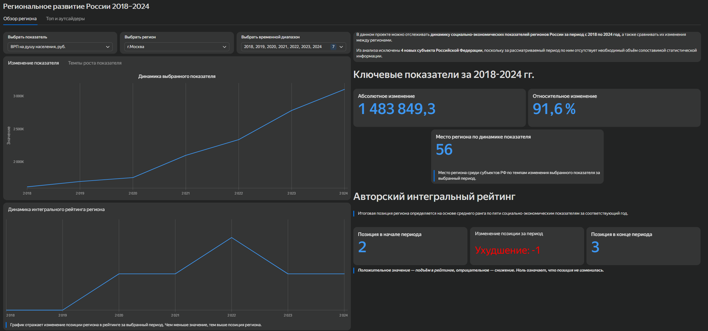

# Анализ социально-экономических показателей регионов России (2018–2024)

## О проекте

В рамках данного pet-проекта проведён анализ открытых статистических данных Росстата о социально-экономическом развитии регионов Российской Федерации за период 2018–2024 годов.

Цель проекта — исследовать динамику ключевых экономических и социальных показателей, сравнить регионы между собой и разработать интерактивный дашборд для представления результатов анализа.

## Инструменты

- **Python** — обработка и подготовка данных.
- **Pandas** — объединение таблиц, расчёт показателей и формирование рейтингов.
- **Yandex DataLens** — создание интерактивного дашборда и визуализация результатов.
- **Git / GitHub** — хранение и публикация проекта.

## Данные и источники

Исходные данные получены из официальных статистических таблиц Росстата и находятся в директории `data/raw/`.

Обработанные CSV-файлы генерируются Python-скриптом `main.py` и сохраняются в `data/processed/`. Подготовленные наборы данных используются для дальнейшего анализа и визуализации.

Исследуемый период — 2018–2024 годы. Новые субъекты Российской Федерации (ДНР, ЛНР, Запорожская и Херсонская области) не включены в исследование ввиду отсутствия сопоставимых статистических данных за выбранный период.

## Основные этапы работы

1. Сбор и изучение исходных статистических данных.
2. Очистка, обработка и объединение данных с использованием Python и Pandas.
3. Расчёт показателей на душу населения и динамики социально-экономических индикаторов.
4. Формирование интегрального рейтинга регионов.
5. Сравнение регионов по отдельным показателям, определение лидеров и аутсайдеров.
6. Создание интерактивного дашборда в Yandex DataLens.

## Методология

Для оценки положения регионов разработан интегральный рейтинг на основе пяти показателей:

- ВРП на душу населения;
- инвестиции на душу населения;
- медианный среднедушевой доход;
- уровень бедности;
- уровень безработицы.

Для каждого показателя рассчитывались региональные места с учётом направления предпочтительности: более высокие значения считаются лучшими для экономических показателей и доходов, более низкие — для бедности и безработицы.

Итоговый рейтинг формировался на основе среднего ранга региона по пяти показателям.

Дополнительно исследовалась динамика показателей за 2018–2024 годы, а также проводилось сравнение регионов по выбранным индикаторам за отдельные годы.

## Результаты

В результате проекта подготовлены унифицированные наборы данных по регионам России и создан интерактивный дашборд, позволяющий:

- анализировать динамику социально-экономических показателей за 2018–2024 годы;
- оценивать изменение положения регионов в интегральном рейтинге;
- сравнивать регионы по отдельным показателям;
- определять лидеров и аутсайдеров по выбранным индикаторам и годам.

## Интерактивный дашборд

[Открыть дашборд в Yandex DataLens](https://datalens.yandex/354tdwx3nx5gm?_share_link=public)

## Структура проекта

```text
Region_Of_Russia/
│
├── data/
│   ├── raw/          # Исходные статистические данные
│   └── processed/    # Обработанные наборы данных
│
├── main.py           # Скрипт обработки данных
└── README.md         # Описание проекта
```
